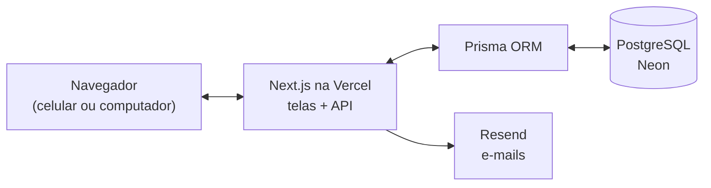

<h1 align="center">Resgata</h1>

<p align="center">
  <b>Achados e perdidos digital do campus</b><br>
  Projeto Integrador Interdisciplinar · Instituto Mauá de Tecnologia
</p>

<p align="center">
  <a href="https://resgata.vercel.app"><b>Acessar o sistema → resgata.vercel.app</b></a>
</p>

---

## O problema

Hoje, quem perde algo no campus posta em grupos de WhatsApp ou murais e espera. A postagem some no meio das outras mensagens, não há como buscar por item, local ou data, e ninguém confirma se quem aparece para retirar o objeto é realmente o dono.

## A solução

O Resgata organiza esse processo em cinco etapas:

| Etapa | O que acontece |
|---|---|
| **1. Registro** | Quem perdeu descreve o item: categoria, cor, local, data e descrição. |
| **2. Achado** | Quem encontrou publica o item e cria uma pergunta secreta sobre um detalhe que a foto não mostra. |
| **3. Match** | O sistema cruza automaticamente perdidos e achados e sugere a correspondência. |
| **4. Validação** | O suposto dono responde à pergunta secreta para provar a posse. |
| **5. Resgate** | Com a resposta certa, o contato é liberado e as duas partes combinam a entrega. |

## Funcionalidades

- **Motor de match automático** com pontuação de 0 a 100
- **Verificação de posse** por pergunta secreta, com limite de tentativas
- **Dashboard** com os matches sugeridos e os itens do usuário
- **Feed público** de itens achados, com busca e filtros
- **Foto do item**, com opção de desfoque para não entregar detalhes
- **Edição e exclusão** dos próprios registros
- **Histórico** de casos resolvidos
- **Tema claro e escuro**, seguindo a preferência do sistema
- **Recuperação de senha por e-mail**

## Como o match funciona

Cada novo cadastro é comparado com os itens do lado oposto (perdidos × achados) e recebe uma nota:

| Critério | Peso |
|---|---|
| Categoria | 35 |
| Local | 30 |
| Cor | 15 |
| Data | 10 |
| Palavras-chave da descrição | 10 |
| **Total** | **100** |

O match é criado a partir de **50 pontos**. A pontuação é parcial, não tudo ou nada: variações como "preto" e "preta" ainda pontuam, e a data tem uma tolerância de 3 dias, porque as pessoas costumam errar quando perderam algo.

## Segurança

| Proteção | Como funciona |
|---|---|
| **Pergunta secreta** | Pergunta e resposta nunca aparecem no feed e são removidas de qualquer resposta pública da API. |
| **Comparação por palavras-chave** | O dono não precisa repetir a frase exata para acertar. |
| **Limite de tentativas** | Após 3 respostas erradas, o match é bloqueado. |
| **Senhas** | Guardadas com hash **bcrypt**, nunca em texto puro, e com regras de força conferidas em tempo real. |
| **Sessão** | Token **JWT** assinado, guardado em cookie. |
| **Força bruta no login** | Após 5 senhas erradas seguidas, aquele e-mail fica bloqueado por 1 minuto. |
| **Recuperação de senha** | Link enviado por e-mail, válido por 30 minutos. |
| **Validação no servidor** | Todos os dados recebidos passam por **Zod** antes de chegar ao banco. |

## Tecnologias

| Camada | Tecnologia |
|---|---|
| Linguagem | **TypeScript** em todo o projeto |
| Front-end | **Next.js** (App Router) + **React** + **Tailwind CSS** |
| Back-end | Rotas de API do **Next.js**, **Zod**, **jose** (JWT), **bcrypt** |
| Banco de dados | **PostgreSQL** acessado pelo **Prisma ORM**, hospedado no **Neon** |
| E-mail | **Resend** |
| Hospedagem | **Vercel**, com deploy automático a cada push na `main` |
| Qualidade | **36 testes automatizados** e **ESLint** |

## Arquitetura



Telas e API ficam no mesmo projeto Next.js. A pergunta secreta é filtrada na API, antes de qualquer dado chegar ao navegador.

## Estrutura do projeto

```
prisma/
├── schema.prisma          # modelo do banco (usuários, itens, matches, verificações)
├── migrations/            # histórico de mudanças do banco
└── clean.ts               # limpa o banco
src/
├── app/
│   ├── (auth)/            # telas de login, cadastro e recuperação de senha
│   ├── (dashboard)/       # dashboard, feed, histórico, itens e matches
│   └── api/               # rotas da API (auth, lost-items, found-items, matches)
├── components/            # componentes visuais reutilizáveis
├── lib/                   # regras de negócio, autenticação, validações e testes
└── types/                 # tipos compartilhados
```

## Como rodar localmente

**Pré-requisitos:** Node.js 18 ou superior e um banco PostgreSQL (o [Neon](https://neon.tech) tem plano gratuito).

```bash
# 1. Clonar e instalar as dependências
git clone https://github.com/fabernav/resgata.git
cd resgata
npm install

# 2. Configurar as variáveis de ambiente
cp .env.example .env
# edite o .env com a conexão do banco e um JWT_SECRET forte

# 3. Criar as tabelas do banco
npx prisma migrate deploy

# 4. Iniciar
npm run dev
```

O sistema abre em `http://localhost:3000`.

### Comandos úteis

| Comando | O que faz |
|---|---|
| `npm run dev` | Inicia o ambiente de desenvolvimento |
| `npm test` | Roda os testes automatizados |
| `npm run lint` | Verifica a qualidade do código |
| `npm run db:clean` | Apaga todos os dados |

O passo a passo de publicação está em [`DEPLOY.md`](DEPLOY.md).

## Equipe

| RA | Nome | GitHub | Responsabilidade |
|---|---|---|---|
| 23.01399-0 | Fabricio Navarro Meira | [@fabernav](https://github.com/fabernav) | Arquitetura, autenticação e deploy |
| 24.00902-4 | Lucas Francisco Alves | [@lucasfalves07](https://github.com/lucasfalves07) | Banco de dados e validações |
| 23.00071-6 | Felipe Ghilardi Lopes de Oliveira | [@FelipeGhilardi](https://github.com/FelipeGhilardi) | Motor de match, verificação de posse e API |
| 23.01191-2 | Vitor Rodolpho Molina | [@VitorRMolina](https://github.com/VitorRMolina) | Interface e experiência do usuário |

---

<p align="center">Projeto Integrador Interdisciplinar · Instituto Mauá de Tecnologia · 2026</p>
